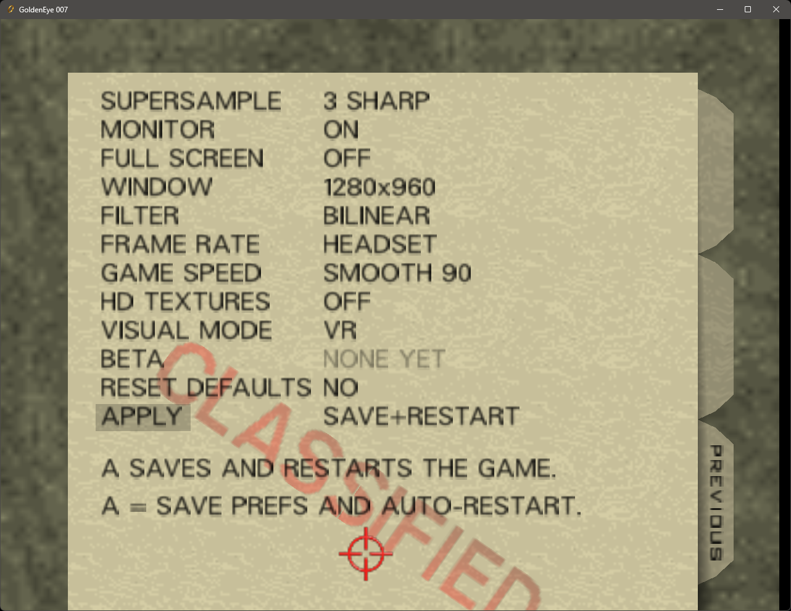

 

# GEVR

**GoldenEye. Native. In VR. Bring your own ROM.**

The N64 classic you can stand inside. GEVR is a from-source PC port of *GoldenEye 007* for real OpenXR VR. You bring a **USA GoldenEye ROM you own**. The zip has **no ROM** and **no HD texture pack**.

> **Latest:** **[vr457](https://github.com/no6969el/GEVR/releases/tag/vr457)** ([`GEVR-Beta-vr457-win64.zip`](https://github.com/no6969el/GEVR/releases/download/vr457/GEVR-Beta-vr457-win64.zip)). Or hit **Update** in GevrRomStarter. Full binds: [docs/CONTROLS.md](docs/CONTROLS.md).

Linux testers: a flat-only Linux alpha is its own prerelease, not Latest. [linux-alpha1](https://github.com/no6969el/GEVR/releases/tag/linux-alpha1).

---

## VR actions

**Right hand is the gun hand. Left hand walks, and the watch cuff stays on that arm.** Quest, Index, and other Oculus-style OpenXR controllers use the same actions. Index names are in [`docs/CONTROLS.md`](docs/CONTROLS.md).

**How to control GEVR in VR** (walkthrough on YouTube): **[watch here](https://www.youtube.com/watch?v=Jst5srE6Iwc)**

### Move

| Control | What it does |
|---|---|
| **Left stick** | Walk and strafe |
| **Right stick** | Turn. **Smooth** or **Snap** is set in **GEVR Settings**. Snap is real degrees |
| **One stick click** | **Weapon wheel** for that hand (circle default; **STICK WHEEL** can set Weapon Vert) |
| **Both thumbstick clicks** | Recenter the playspace |
| **Head / room-scale** | Look around. Walk your room to move in the level |
| **Left stick while aiming** | Walk forward and back |
| **Right stick up or down while aiming** | Stand or crouch |

VR has **no walk bob**, **no landing dip**, and **no gun-hand sway**.

### Fight

| Control | What it does |
|---|---|
| **Right trigger** | Fire the gun in your **right** hand |
| **Left trigger** | Fire the gun in your **left** hand. It fires on its own, even when you are not dual-wielding |
| **Grip** | Aim down the gun |
| **Grip near a door** | Open or close it |
| **Right A** | Next weapon on the **right** hand |
| **Left X** | Next weapon on the **left** hand |
| **Right B** | **USE**: switches, plant, activate. Gun reload is the VR gesture. Tank shells auto-load |
| **Stick click** | Weapon wheel for that hand. Circle default. Centre follows your hover. Boxes are 2x dark grey |
| **Right grip at hip** | **Holster swap**. Same-gun hip grip is a real swap. Inventory prefers a free copy over the hip gun |
| **Left grip on the fore-end** | Two-hand hold for a rifle, shotgun, or SMG in the right hand |
| **Grip near a gun on the ground** | Pick it up into that hand |
| **Walk over a gun** (Auto pickup, New) | Both hands empty: into your right hand. A gun already in hand: into your inventory. **AUTO PICKUP** in GEVR Settings turns this off |
| **Hold the grip on a gun a few steps away** (Force-pull) | The gun flies to you. Hold until it arrives and it stays in your hand; let go while it is flying and it lands in your inventory |
| **Stick click with a gun in hand** (New) | The gun is put away into your inventory |
| **Hands together, squeeze both grips** (New) | With a gun in each hand, the two guns swap hands |
| **Grip on your own stuck mine** | Pick a remote mine, or an arming proximity mine, back up |
| **Swing** | Uses the damage of the weapon in that hand |

A lone gun in the left hand still fires with the left trigger. Dual-wield is only when you hold two guns. Grenades, mines, and gadgets show in the hand. The trigger throws or fires them. Left-hand throwables draw the right way around.

**Moonraker:** look and shoot through the small circular scope lens. Dual Moonrakers give two lenses. No big front grill screen. **Rockets** stay locked to the launcher, not your head. Flat mouse-aim crosshair stays centred. **Aimers** (red and green) sit on the shot's first hit.

### Watch

| Control | What it does |
|---|---|
| **Y** | Opens the watch |
| **Menu** | Also opens the pause watch |
| **Watch picker on left cuff** | Three squares with pictures and labels: **Laser / Magnet / Repel** |
| **GAME OPTIONS** | Go past ratio. The last line says scroll down for VR settings |
| **Cuff grab** | Laser, detonate remotes, or magnet (per picker / pause watch). Magnet is unlimited in VR |

There is no detonator in the weapon cycle. The full bind list is in [`docs/CONTROLS.md`](docs/CONTROLS.md).

---

## vr457

New hands and arms, pickup options, a scope magnifier, Enhanced and Dynamic weather, optional Tactical enemy AI, a Train fix, and GEVR Settings as pages. This is the vr456.9 build plus those changes.

**Passed** means tested in a headset on an earlier test build. **New** means built and checked on the bench, not yet tested in a headset. Please try the New items and report. This release as a whole has not had a full headset pass.

### Defaults for a fresh install

Hands and arms on. Weather Original (no falling weather). Enemy AI Classic (the original guards). Auto pickup on. Instant gesture reload (the physical magazine reload is off). Squad chatter muted. Scope magnifier on. Pull and disarm on. Upscaler off. Change any of them in **GEVR Settings** and press **Apply**. Your saved choices always win over these defaults.

### Pickups (New)

- **Auto pickup** (on by default). With both hands empty, walk over a gun on the floor and you pick it up straight into your right hand. With a gun already in a hand, walking over another gun puts it in your inventory. A second copy of a gun you already own gives the dual pair in your inventory; a third copy gives ammo only. Turn **AUTO PICKUP** off in GEVR Settings (HANDS AND GUNS page) and the gun stays on the floor until you grab or pull it.
- **Force-pull landing.** Point a hand at a gun a few steps away, squeeze the grip, and keep holding until it arrives: it lands in your hand and stays there when you let go. Squeeze, then let go while it is still flying: it lands in your inventory instead. With a gun already in one hand, pulling another with the free hand sends it to your inventory.
- **Stick click.** With a gun in your hand, clicking a thumbstick puts the gun away into your inventory.
- **Two-gun swap.** Hold a gun in each hand, bring your hands together, and squeeze both grips at nearly the same moment. The two guns swap hands.

### Hands and arms (New, on by default)

Look down at your hands: one clean hand and sleeve per side, arms that follow your body, and a closed watch band around the left wrist with the watch case on top. Small guns are drawn from your jacket and long guns from over your shoulders. Grenades and mines keep the old hold for now. To go back to the old hands and hip holsters, set **HANDS AND ARMS** to Off in GEVR Settings (HANDS AND GUNS page), or untick **New hands** in the launcher Options tab, then Apply or Start.

### Scopes (New)

Pick up the sniper rifle (or use the Moonraker lens) and bring your eye toward the scope. The scope picture grows as your eye gets close: full size beyond about 30 cm, up to two and a half times bigger at about 12 cm. You no longer have to press the headset against it. The zoom level itself does not change.

### Weather (New: Enhanced and Dynamic)

Open **GEVR Settings > WEATHER**. **Original** is the game as it was and is the default. **Off** turns weather off. **Enhanced** adds snow and rain on the levels that have it, now also out across the yard (about 18 metres). **Dynamic** lets the weather change by itself over time. Other rows: intensity, weather type, ground effects (splashes, prints in snow, wet floors), lightning flashes, whether the weather hinders Tactical guards, and a seed for repeatable weather. Weather rows take effect at the next level load. The weather never changes the game's fog, draw distance or sky colour. If you see everything turn blue near your face, tell us.

### Enemy AI (New, optional)

Leave **ENEMY AI** on **Classic** for the original guards (default). **Tactical** and **Tactical+** make guards use cover, flank, call for help and fall back; they fire first when they meet you close up and turn and fire if they run away from you. The **AGGRESSION** row (Calm to Ruthless) sets how hard they push. Squad radio chatter is muted; spotted shouts and man-down yells still play. Tactical and Tactical+ have not passed a headset test, so some guards may ignore you or act strangely. Classic is the safe choice.

### Train (New)

Do the brakes objective on Train. You should hear the brake sound and the two key guards should leave their posts instead of standing there for ever. The same fix applies to other levels where a guard waits for "objective N complete".

### Passed in the headset (earlier test builds)

- VR eyes no longer follow the desktop window or Supersample.
- **VR render scale**, 50 to 150 percent (launcher Options tab, or the VR RENDER SCALE row in GEVR Settings). A very large headset at 150 is capped to what the runtime allows.
- Multisample anti-aliasing in VR sizes itself to your graphics memory (steps down 8x, 4x, 2x, off if it does not fit).
- **Force-pull:** point a hand at a gun, ammo, key or armour and squeeze the grip; it flies to your hand. Pointing down at small items searches a little wider.
- **Pull and disarm:** force-pull a gun out of a guard's hand. You should hear a magnet sound and see the watch glow.
- Door and wall buttons press when you touch them; hinged doors push open with your palm.
- Held items follow your hand and drop onto whatever is below. Menus and cinema fit one eye's picture, and there is no white flash between menus and a level.

### Known issues / in progress

- The plastique from All Weapons can keep exploding and follow you. Leave All Weapons off when you place plastique.
- Hands and arms: the thumb sits oddly on some guns (small, or not wrapped around the grip; on the shotguns it can point up). The four fingers are fine.
- KF7 Soviet: with the hands on, looking at the left side of the gun draws the inside of the palm over the grip; from the right side the gun shows and the hand does not.
- Tactical and Tactical+ enemy AI are options, not the default, and have not passed a headset test.
- Multiplayer bots are not included.
- The physical magazine reload (squeeze to pull the magazine out) is off; it is still experimental. The normal gesture or chest reload is unchanged.
- The first time HD textures appear in a level you may feel a short hitch.
- Windowed only (no Fullscreen toggle).

### Beta rows (off)

Under **GEVR Settings > BETA**: **HD TEXTURE SET** (Off, GE007 HD, GEVR Curated, or Curated plus AI fills) needs a folder of pictures on your own disk; the zip has none. **UPSCALER** needs an RTX card and NVIDIA's own runtime files, which are not in this zip; without them the row does nothing and the game stays on plain OpenGL.

### Carried from earlier cuts

Everything below still applies.

### Stick weapon wheel

Click and hold a stick. The default is a **circle**. **NO WEAPON** sits at 12 o'clock. The centre follows your hover. Boxes are 2x dark grey. **STICK WHEEL** in GEVR Settings can switch to **Weapon Vert** (a column). Change the row, unpause, then the next stick-click uses the new style. No reboot.

### Holster and weapon switch

Hip grip on the same gun is a real swap. Weapon switch prefers a free inventory copy over the holstered hip gun. **Left X** and **Right A** both step **next** weapon on that hand.

### Watch picker

Pictures and labels on the left cuff: Laser / Magnet / Repel. Magnet is unlimited in VR (no ammo spend, no DRY). Laser and Repel stay on the normal watch item flow.

### Moonraker and rockets

Moonraker is a small circular scope lens only. Look through the ring. Shoot through the ring. Two Moonrakers, two lenses. No front grill screen. Sniper still uses the round plate with the green dot. Rockets stay on the launcher. Flat crosshair stays centred.

### Tank, snap, aimers, HD memo, XR

Tank shells auto-load the next round after you fire. Snap-turn is real degrees (15 / 22.5 / 30 / 45 / 60 / 90). Red and green aimers sit on the shot's first hit. HD memos keep decoded HD pictures in memory (`GETV_HD_MEMO_MB=0` turns that off). Missed headset frames no longer slow the sim. Quitting actually quits.

### Visual modes

You can play in **VR**, in **XR**, or **Flat** on the monitor. XR is a smaller screen with a black outline. Open **GEVR Settings**, change the Visual mode row, and choose **Apply**. Apply saves and relaunches into that mode.

### Frame rate

Frame rate follows the headset by default. Fixed 90 is still available on that row.

### Picture size and filter

In VR, **VR RENDER SCALE** sets the picture size (50 to 150 percent). Flat mode keeps Supersample. The texture filter starts on bilinear. Point is still available.

### Monitor picture

Choose **Both**, **Left**, **Right**, or **Off**. Off blanks the mirror on the monitor while you stay in the headset.

### Where GEVR Settings lives

On **Mission Select**, **GEVR Settings** sits next to **Select Mission**, **Multiplayer**, and **Cheat Options**. It is not named Options. In VR, look at that glass on the intro hub.

GEVR Settings is now a set of pages: **GRAPHICS**, **VR**, **HANDS AND GUNS**, **WEATHER**, **ENEMY AI** and **BETA**, then **RESET DEFAULTS** and **APPLY** on the first page. The full list of rows is in [docs/GEVR-SETTINGS.md](docs/GEVR-SETTINGS.md).

**A** selects a row. The stick **left** or **right** changes the value. **A** accepts. Highlight **Apply** and press **A** to save and relaunch.

| Row | Starts at |
|---|---|
| VR render scale (Supersample in Flat) | 50 to 150 percent in VR |
| Monitor | Both |
| Full screen | Off |
| Window | 1280x960 |
| Filter | Bilinear |
| Frame rate | Headset |
| Game speed | Smooth 90 |
| HD textures | Off |
| Visual mode | VR |
| STICK WHEEL | Weapon wheel (circle) |
| Hands and arms | On |
| Auto pickup | On |
| Weather | Original |
| Enemy AI | Classic |
| Upscaler | Off |
| HD texture set | Off |
| Reset defaults | No |
| Apply | Save and relaunch |

Each mode keeps its own saved settings. Switch Visual mode when you want to edit a different one. The monitor row is for VR and XR. It is greyed out in Flat.

 

### Reload

Reload guns with the gesture (the default is an instant gesture reload; the physical magazine reload is off for now, and a chest cross works on pistols and guns with no mag). **B** is USE, not VR gun reload. Tank shells auto-load. Grabbing the handle swaps hands and does not reload.

### Left hand

A gun in the left hand fires on its own with the left trigger.

### Ammo and weapon pictures

Ammo digits sit on the grip and read from behind the gun. Flat mode keeps the corner count. Weapon pictures sit on the lifting hand, including the grenade and mines.

### Mines

Remote, proximity, and timed mines draw in the hand like the grenade.

### Swing

A swing uses the damage of the weapon you are holding. Shooting does not make the knife swing by itself.

### Sniper

A green dot stays on. Shots leave the eye along that dot. Push the right stick forward or back to step the zoom through 30, 20, 15, 10, and 7. Walking does not zoom.

### Watch

Press **Y** to open the watch. On the **GAME OPTIONS** sheet, go past ratio. The last line says scroll down for VR settings. Cuff press follows the picker / pause watch (laser, auto detonate, or magnet). There is no detonator in the weapon cycle.

### Janus meeting

The crowd stops respawning after the meeting.

### HD textures

The zip does not include a texture pack. If `hdtextures` only has `GOLDENEYE_HIRESTEXTURES.hts`, that is the wrong file. An `.hts` file there does nothing.

1. Download a GLideN64 **PNG** zip, not the `.hts` file. [GoldenEye-007-HD releases](https://github.com/GhostlyDark/GoldenEye-007-HD/releases) or the [GE007 HD texture pack page](https://evilgames.eu/texture-packs/ge007-hd.htm).
2. Put the pictures in `hdtextures\GOLDENEYE`, next to `goldeneye.exe`. Do not rename the picture files.
3. Turn **HD textures** **On**.
4. Choose **Apply**.
5. The pack loads on the next boot.

Playspace movement, grip doors, the tank, and recenter are still in. Details: [FEATURES.md](FEATURES.md).

Not in this build: live wrist watch panel, throwing any prop, multiplayer bots, DLSS frame generation and neural upscaling.

---

## Install

| | |
|---|---|
| **Download** | [**GEVR-Beta-vr457-win64.zip**](https://github.com/no6969el/GEVR/releases/download/vr457/GEVR-Beta-vr457-win64.zip) |
| **Release page** | [vr457](https://github.com/no6969el/GEVR/releases/tag/vr457) |
| **Latest** | [Releases / Latest](https://github.com/no6969el/GEVR/releases/latest) |
| **Controls** | [docs/CONTROLS.md](docs/CONTROLS.md) |
| **Report a bug** | [New Issue](https://github.com/no6969el/GEVR/issues/new/choose) |
| **Discord** | [discord.gg/flat2vr](https://discord.gg/flat2vr) |
| **Features** | [FEATURES.md](FEATURES.md) |
| **Support** | [Patreon](https://www.patreon.com/cw/GEVR) |

1. Download **[GEVR-Beta-vr457-win64.zip](https://github.com/no6969el/GEVR/releases/download/vr457/GEVR-Beta-vr457-win64.zip)** from [Latest](https://github.com/no6969el/GEVR/releases/latest) / [vr457](https://github.com/no6969el/GEVR/releases/tag/vr457). The zip has no ROM and no HD texture pack.
2. Unzip anywhere.
3. Run **`Start-GEVR.bat`**. It starts **GevrRomStarter.exe**.
4. Point at your **USA GoldenEye `.z64`** when asked. Images extract to `%LOCALAPPDATA%\GEVR\cache\<ROM-hash>\`. The first launch after an update rebuilds that cache once from your ROM.
5. Put the headset on. Recenter with **both thumbstick clicks**.
6. On **Mission Select**, open **GEVR Settings** (next to Select Mission, Multiplayer, and Cheat Options) and tune the picture.

Use the bat. Do not start bare `goldeneye.exe`.

The game starts in **VR**. For a monitor with no headset, run **`Play-on-monitor.bat`**. You can also set Visual mode to **Flat** and Apply.

**New install:** the first launch waits once while images prepare. Saves start empty.

**After an update:** keep the same USA `.z64`. Saves and GEVR Settings stay under `%LOCALAPPDATA%\GEVR`. Or use **Update** in GevrRomStarter. If the picture is wrong, try **`Clear-GEVR-cache.bat`** (type **YES**) before you delete the whole `%LOCALAPPDATA%\GEVR` folder.

---

## Older playtest (video)

This clip is from an older public cut. Picture and controls may not match **vr457**.

[Watch on YouTube](https://www.youtube.com/watch?v=z4B0Ceqrf6I)

---

## What we tested

| Path | Notes |
|------|--------|
| **Pimax Crystal Super + SteamVR OpenXR** via [CustomHeadsetOpenVR](https://github.com/sboys3/CustomHeadsetOpenVR) (sboys3) | Primary wear path. We do not maintain that driver; we *do* support this experience |
| **Native PimaxXR** | Verified attach / play |
| **Meta Quest 3 + Virtual Desktop OpenXR (VDXR)** | Verified attach / play |
| **RTX 5060 laptop + Quest 3 + Virtual Desktop VDXR** | One data point, not a minimum spec |

**Half-speed or mushy VR?** Turn **SteamVR Motion Smoothing Off** and **Virtual Desktop Space Warp Off**. Details: [`docs/BETA.md`](docs/BETA.md#half-speed--mushy-vr).

When you report a bug or crash, include: **headset**, **OpenXR runtime**, **SteamVR on/off**, **HMD vs monitor**, whether you used **`Start-GEVR.bat`**, your **`gevr-*-boot.cmd`** filename from the zip folder, any log next to the zip or in the console, and any **`gevr-fault-*.txt`** beside the exe. Do **not** upload your ROM.

---

## Discord (help + fan chat)

**[Join the GEVR Discord](https://discord.gg/flat2vr)** for port help and GoldenEye fan chat. Bring your own ROM. Do not upload it. GitHub Issues stay the place for tracked bugs.

---

## Known quirks (honest Beta)

- **Half-speed or mushy VR:** SteamVR **Motion Smoothing Off**; Virtual Desktop **Space Warp Off** ([BETA.md](docs/BETA.md#half-speed--mushy-vr)).
- **Frigate door** and other level stoppers are still being worked on.
- Some Dam and Frigate water and prop looks are still off.
- A swing uses the held weapon's damage. It is in, and it is not finely tuned.
- **Big explosions** can still hard-crash. Grab `gevr-fault-*.txt` beside the exe before you relaunch.
- With the old hands (**HANDS AND ARMS** Off), an empty hand draws a **cube**. The cube hides when that hand holds a weapon.
- Expect occasional **crashes** while we keep polishing.

More tester notes: [BETA.md](docs/BETA.md) · [CONTROLS.md](docs/CONTROLS.md).

---

## Why this exists

- **Native / from-source:** the game loop is ours, so VR can be real
- **OpenXR:** Crystal, Quest via PC, SteamVR-class headsets
- **Your ROM:** you keep the cart you own
- **Feel first:** stand in the room, aim with your hands, then polish

More pitch: [FEATURES.md](FEATURES.md). Credits: [CREDITS.md](CREDITS.md). Boundaries: [PRIOR-ART.md](PRIOR-ART.md), [LICENSE](LICENSE). Other projects using GEVR: [docs/OTHER-PROJECTS.md](docs/OTHER-PROJECTS.md).

---

## Docs (player)

- Start: [`docs/00-START-HERE.md`](docs/00-START-HERE.md)
- Controls: [`docs/CONTROLS.md`](docs/CONTROLS.md)
- Settings: [`docs/GEVR-SETTINGS.md`](docs/GEVR-SETTINGS.md)
- Beta snapshot: [`docs/BETA.md`](docs/BETA.md) · [`docs/FEATURES-CURRENT.md`](docs/FEATURES-CURRENT.md)
- Other projects: [`docs/OTHER-PROJECTS.md`](docs/OTHER-PROJECTS.md)

Jump in and enjoy finally being Bond in GoldenEye VR.
